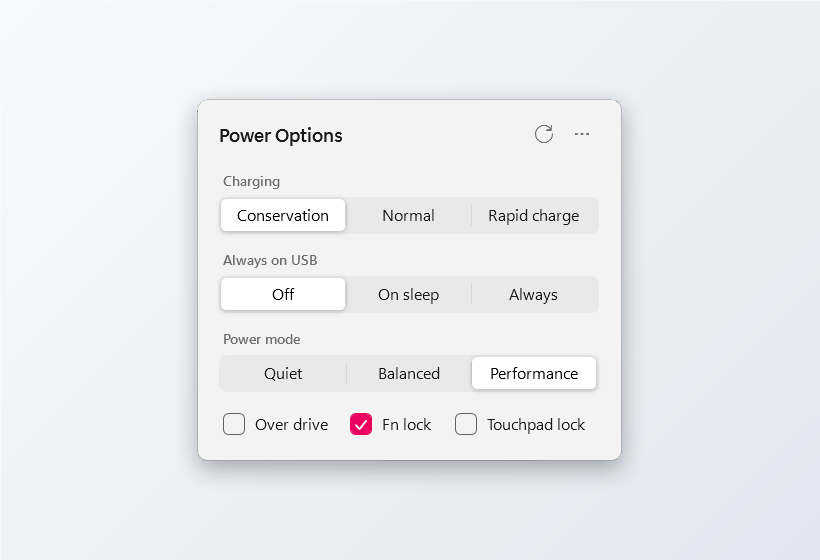

# Lenovo Controller

> A lightweight alternative to Lenovo Vantage

## Tested laptops

- Legion 7 2020
- Ideapad 510S-14ISK
- LOQ 15iax9e

## Disclaimer

While this program is made with best efforts to be safe, stable, and support all Lenovo laptops, I cannot guarantee that it won't break something on your device. Use it at your own risk.

## Fork differences

- ### Tray popup

  The app starts quietly in the notification area. Its icon mirrors the active power mode.

- ### Windows 11 native look

  Frosted **Mica** backdrop, system light/dark theme.

- ### Localization support

  Available languages: English, Russian

## Features

- ### Minimalistic interface

  

- ### Light on RAM

    <table>
    <tr>
        <th>Lenovo Vantage (253MB)</th>
        <th>LenovoController (16MB)</th>
    </tr>
        <tr>
            <td></td>
            <td></td>
        </tr>
    </table>

- ### No telemetry, ads, or any other bloat

  [Reddit discussion about Vantage](https://www.reddit.com/r/Lenovo/comments/iabq0q/bloat_lenovo_vantage_now_pushing_snake_oil/)

- ### Works without UWP, the Microsoft Store, or any internet at all
  May even support Windows 7 if the drivers are the same

## Dolby and microphone controls

You can use the official apps:

- [Dolby Atmos for Gaming](https://www.microsoft.com/store/productId/9N00HQPF5RJ6) (Dolby)
- [Smart Microphone Setting](https://www.microsoft.com/store/productId/9PMHKXF40N04) (microphone controls)
- [Realtek Audio Console](https://www.microsoft.com/store/productId/9P2B8MCSVPLN) (speaker and microphone controls)
